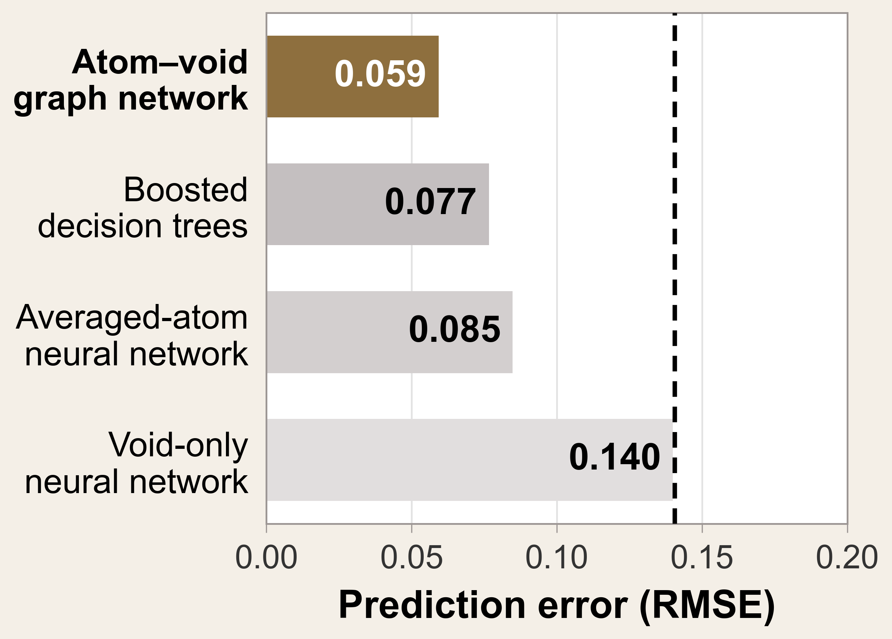
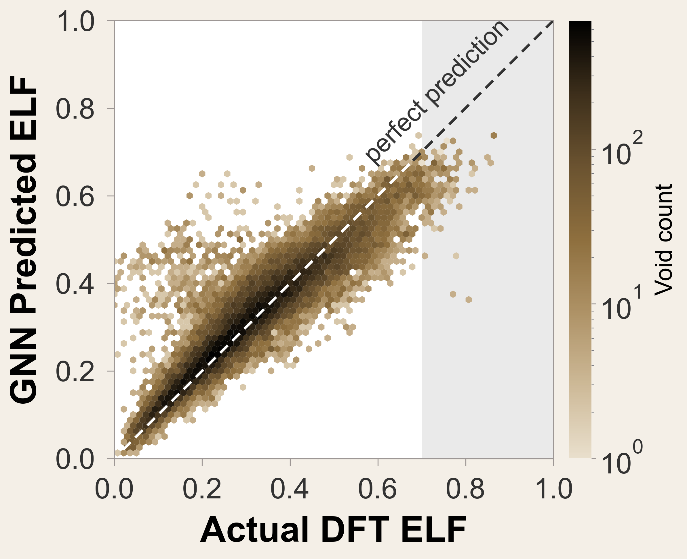

# Electride ML Predictor

Machine-learning and geometry tools for finding and characterizing **electrides**: crystals in which some of the electrons do not belong to any atom but sit in empty spaces (*voids*) between the atoms.

## Background

In most crystals, electrons are bound to atoms or shared in bonds between them. In an electride, some electrons occupy interstitial sites and act like negatively charged "anions" without a nucleus. Ca₂N is the textbook example: electrons sit in the gaps between its calcium–nitrogen layers. Electrides have unusual electronic and catalytic properties, but only a few dozen are known, and confirming a candidate normally requires an expensive density-functional theory (DFT) calculation.

This project asks whether electrides can be recognized from the crystal structure alone, by looking at each interstitial void separately and answering two questions.

| Question | What it means | How this repo answers it |
| --- | --- | --- |
| **Is there room?** | Does a void exist, and is the empty space around it an isolated pocket (0D), a channel (1D), a layer (2D) or a connected 3D network? | A geometric **void connectivity identifier** that works from atomic positions only. |
| **Is an electron there?** | How strongly is electron density localized at the void? | A **graph neural network (GNN)** that predicts the DFT *electron localization function* (ELF) at each void. |

ELF is a number between 0 and 1 computed from DFT. High values mean electrons are strongly localized (as in bonds, lone pairs, or electride cavities); about 0.5 is uniform-gas-like. A void with a high ELF value is a candidate site for an interstitial electron.

## How it works

```text
Crystal structure (POSCAR / CIF)
        │
        ▼
1. Find candidate voids                 void_detection/, elf_void_analysis/
   Periodic Voronoi interstitials and local maxima of the distance to the
   nearest atom; merged and expanded to the full crystal symmetry.
        │
        ├─────────────► 2a. Void connectivity (0D / 1D / 2D / 3D)
        │                   elf_void_analysis/power_void_connectivity.py
        │                   Exact power-diagram (radical Voronoi) network of the
        │                   space a probe can reach; the label comes from how many
        │                   independent periodic directions each region spans.
        ▼
2b. Build an atom/void graph            elf_void_analysis/
   Atoms and voids are nodes; periodic atom–atom, atom–void and void–void
   edges carry distances. Structure-derived features are inputs.
        │
        ▼
3. Train a heterogeneous GNN            elf_void_gnn/
   Message passing between atoms and voids; output is one predicted ELF
   value per void. DFT ELF values are labels only, never inputs.
```

**Training data.** The GNN is trained on about 50,000 paired crystal structures and DFT ELF grids from the public ELFNet corpus, which gives hundreds of thousands of voids. Structures are split into train / validation / test by *named phase family* (40,031 / 4,969 / 5,000 structures), so that near-identical structures do not land on both sides.

## Results

Predicting ELF at void centers on the held-out test families (root-mean-square error, lower is better; mean ± standard deviation over three random seeds):

| Model | Test RMSE |
| --- | ---: |
| **Atom–void GNN, atomic features only** | **0.059 ± 0.003** |
| Atom–void GNN, with extra hand-built void descriptors | 0.070 ± 0.001 |
| Gated message-passing GNN | 0.070 ± 0.003 |
| Gradient-boosted trees | 0.077 |
| MLP on a fixed neighborhood summary | 0.085 ± 0.002 |
| MLP on void features only | 0.140 ± 0.000 |





What this shows:

- **Message passing between atoms and voids matters.** Models that see only the void, or only a fixed summary of its surroundings, have roughly 1.5–2.5 times the error.
- **Simple inputs win.** Explicit void descriptors (clearance, shape measures, and so on) did not improve held-out accuracy; the network learns a void's environment better from atomic properties and graph geometry.
- **Model size barely matters.** Width 128 versus 64 and added gated recurrence gave no reliable gain.
- **Limits.** All results use one train/validation/test split and three seeds, so the spread reflects training variability, not independent test sets. Related compositions or pressures can appear on both sides of the split, so this measures generalization to held-out named phases, not to unseen chemistry.

Each study has its own write-up:
[architecture comparison](elf_void_gnn/architecture_test/RESULTS.md) ·
[feature ablations](elf_void_gnn/feature_study/RESULTS.md) ·
[confirmation study](elf_void_gnn/confirmation_study/results_voidv2/README.md).

## Void connectivity

The connectivity identifier classifies how the empty space around each void is connected, using only atomic positions and radii. It was checked against literature electrides with known dimensionality, for example K₄Al₃(SiO₄)₃ (0D pockets), Ba₃CrN₃ (1D channels) and Ca₂N (2D layers); see [`elf_void_analysis/case_studies/`](elf_void_analysis/case_studies/). The geometric label tells you whether a void *could* hold a delocalized electron network; the GNN tells you whether electron density is actually localized there. Combining them into a crystal-level electride score is future work.

## Repository layout

| Path | Contents |
| --- | --- |
| [`void_detection/`](void_detection/) | Periodic candidate-void finder |
| [`elf_void_analysis/`](elf_void_analysis/) | ELF labeling, void connectivity, graph and HDF5 dataset construction, validation, tests, literature case studies |
| [`elf_void_gnn/`](elf_void_gnn/) | GNN models, data loader, training and metrics; architecture, feature and confirmation studies |
| [`dft/`](dft/) | Quantum ESPRESSO (PBE) and CP2K workflows for six reference materials (Ba₂As, Ba₃CrN₃, Ca₂N electrides; MgS, BaSn₃, Cu₂SiSe₃ controls) |
| [`data/`](data/) | Example structures and an electride registry used by the case studies |
| [`poster/`](poster/) | Research poster and the scripts that generate its figures |
| [`docs/`](docs/) | [Project scope](docs/PROJECT_SCOPE.md) (the fullest description), [write-up](docs/project_writeup.md), [timeline](docs/project_timeline.md) |

## Getting started

```bash
git clone https://github.com/weilana30/electride-ml-predictor.git
cd electride-ml-predictor

# Void finding and connectivity (needs pymatgen, scipy, h5py, pyarrow)
pip install -r elf_void_analysis/requirements.txt

# Classify the void connectivity of a structure
python -m elf_void_analysis.power_void_connectivity data/cifs/mp-2686.cif \
  --output /path/outside/repository/Ca2N --radius-scheme ionic --probe-radius 1.0

# GNN (install PyTorch first; see the header of the requirements file)
pip install -r elf_void_gnn/requirements-rocm63.txt
python -m unittest discover -s elf_void_gnn/tests -v
python -m elf_void_gnn.train --help
```

Building the graph dataset and training from scratch requires the ELFNet POSCAR/ELFCAR files and a GPU; the exact commands are in [`elf_void_gnn/REPRODUCIBILITY.md`](elf_void_gnn/REPRODUCIBILITY.md), and the dataset's origin, format and fingerprints are in [`elf_void_gnn/DATASET_PROVENANCE.md`](elf_void_gnn/DATASET_PROVENANCE.md).

## Data policy

Raw ELFNet files, generated graph shards, model checkpoints, cluster logs and per-void prediction files are large and are deliberately **not** stored in this repository. Their locations and checksums are recorded in the provenance document above.
