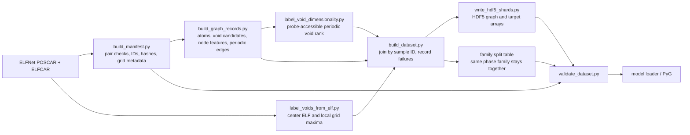

# ELFNet atom/void graph dataset

This package builds a model-ready dataset from the ELFNet POSCAR/ELFCAR pairs.
The graph has atom and candidate-void nodes, with periodic atom–atom,
void–atom, and void–void edges. Structure-derived graph arrays are model inputs.
ELF values and geometric accessible-space dimensionality are stored separately
under `targets/`.

## Workflow



| File | Responsibility | Output or contract |
|---|---|---|
| `build_manifest.py` | Index paired files, make stable sample/family IDs, parse POSCAR atom counts and ELFCAR grid dimensions, optionally hash source files | `manifest.parquet` |
| `build_graph_records.py` | Read POSCAR, run the existing candidate-void finder, expand each reduced candidate into unique symmetry-equivalent unit-cell nodes, create node features, and enumerate periodic atom–atom, void–atom and void–void edges | In-memory graph record; no ELFCAR targets |
| `label_voids_from_elf.py` | Check that POSCAR and ELFCAR structures match; interpolate ELF at each void and measure local grid maxima and offsets | Per-void target arrays |
| `label_void_dimensionality.py` | Threshold a periodic grid by nearest-atom clearance, label accessible components and compute independent winding rank | Per-void `void_dimension` and validity arrays plus definition metadata |
| `build_dataset.py` | Orchestrate the two extraction paths, join by sample, record failures, make family-safe splits | Complete version directory |
| `write_hdf5_shards.py` | Validate records and atomically write numeric arrays and UTF-8 metadata | `shards/graphs-*.h5` |
| `schema.json` | Describe manifest and HDF5 storage contracts | Copied into each built dataset |
| `dataset.py` | Load a stored graph and optionally convert it to PyG `HeteroData` | Model input; `targets/` stays separate from `x` |
| `validate_dataset.py` | Check HDF5 shapes, edges, targets, manifest/split membership and optionally source files | JSON validation report and optional void CSV |
| `dataset_config.json` | Store graph cutoffs, ELF label radii, dimensionality probe/grid spacing, split seed/fractions and shard size | Versioned build settings |

## Stored output

```text
gnn_void_dataset/v1/
├── config_used.json
├── schema.json
├── manifest.parquet       # one row per source sample directory, including failures
├── splits.parquet         # one row per successfully built sample
├── build_report.json      # counts, fingerprint, and per-sample failures
└── shards/
    ├── graphs-00000.h5
    └── graphs-00001.h5
```

Each HDF5 shard follows this layout:

```text
/samples/<sample_id>/
├── lattice_angstrom                 float [3, 3]
├── atoms/
│   ├── fractional_coords            float [n_atoms, 3]
│   ├── atomic_numbers                integer [n_atoms]
│   ├── features                      float [n_atoms, n_atom_features]
│   └── feature_validity              integer [n_atoms, n_validity_features]
├── voids/
│   ├── fractional_coords             float [n_voids, 3]
│   ├── features                      float [n_voids, n_void_features]
│   ├── method_multi_hot              integer [n_voids, n_methods]
│   ├── void_id                       UTF-8 [n_voids]
│   ├── orbit_id                      UTF-8 [n_voids]
│   ├── orbit_member_index            integer [n_voids]
│   └── orbit_multiplicity            integer [n_voids]
├── edges/
│   ├── atom_atom_index               integer [2, n_edges]
│   ├── atom_atom_distance_angstrom   float [n_edges]
│   ├── atom_atom_image_shift         integer [n_edges, 3]
│   ├── void_atom_index               integer [2, n_edges]
│   ├── void_atom_distance_angstrom   float [n_edges]
│   ├── void_atom_image_shift         integer [n_edges, 3]
│   ├── void_void_index               integer [2, n_edges]
│   ├── void_void_distance_angstrom   float [n_edges]
│   └── void_void_image_shift         integer [n_edges, 3]
├── targets/
│   ├── elf_at_center                 float [n_voids]
│   ├── elf_max_0.5A / 1A / 1.5A      float [n_voids] per radius
│   ├── offset_0.5A / 1A / 1.5A      float [n_voids, 3] per radius
│   ├── void_dimension               int8 [n_voids], rank 0–3 or -1
│   └── void_dimension_valid         uint8 [n_voids], 1 valid / 0 invalid
└── metadata/                         source paths, family, counts and settings
```

Edges are directed. Each `*_index` array has source indices in row zero and
destination indices in row one. The corresponding periodic `image_shift` is
added to the destination's fractional coordinate; all destination images
inside the configured cutoff are retained. Void–void edges store both
directions, exclude zero-shift self edges, and retain translated periodic self
images.

## Full build on Negishi

The local builder is serial. For the complete 50,000-sample dataset on Negishi,
use the single-node parallel workflow in
[`cluster/negishi/README.md`](cluster/negishi/README.md). It prepares one
manifest, builds independent chunks across one 128-core node, then merges them
and generates family-level splits globally.

## Build a bounded pilot

Use a new output path for each build. The builder refuses to write into a
nonempty directory, preventing old shards from being mistaken for current
outputs. Start with a small pilot, inspect its report, then choose a fresh
version output directory for the full run.

```bash
python -m pip install -r elf_void_analysis/requirements.txt
python -m elf_void_analysis.build_dataset \
  --limit 3 \
  --output elfnet_data/gnn_void_dataset/pilot-3
```

`--limit` limits the first sample directories in stable path order. Remove it
for a complete build, and provide a different `--output` path:

```bash
python -m elf_void_analysis.build_dataset \
  --output elfnet_data/gnn_void_dataset/v1
```

Validate the completed output (the validator checks every shard against the
manifest and split table):

```bash
python -m elf_void_analysis.validate_dataset \
  --shards 'elfnet_data/gnn_void_dataset/v1/shards/*.h5' \
  --manifest elfnet_data/gnn_void_dataset/v1/manifest.parquet \
  --splits elfnet_data/gnn_void_dataset/v1/splits.parquet \
  --schema elfnet_data/gnn_void_dataset/v1/schema.json \
  --source-root elfnet_data/extracted/dft-reference/dft-reference-elfs-50000-v1 \
  --require-full-coverage \
  --report-json elfnet_data/gnn_void_dataset/v1/validation.json
```

## Symmetry-expanded void nodes

Each symmetry-reduced candidate expands into its unique symmetry images inside
the unit cell before void–atom and void–void edges or per-void targets are
calculated. Thus each row in `voids/` and `targets/` corresponds to a physical
unique unit-cell site. `orbit_id` groups sites from one finder representative;
`orbit_member_index` indexes the lexically sorted wrapped member coordinates;
and `orbit_multiplicity` repeats the unique member count on every row.
`void_id` combines the representative and member indexes and is unique within
its sample. If symmetry analysis fails, each finder representative is retained
as a singleton orbit (member index 0, multiplicity 1), and the fallback status
is recorded in `metadata/settings/void_symmetry_expansion_status` as
`fallback_representatives_symmetry_analysis_failed`; successful expansion uses
`expanded`. The symmetry operation count and tolerance are also stored in the
settings metadata. All ELF and dimensionality labels use the expanded node
order, so each physical unit-cell site receives its own target.

## Current target interpretation and limits

The labels are ELFCAR `total` grid values. `elf_at_center` is periodic
trilinear interpolation at the candidate coordinate. A local maximum is the
largest raw grid sample inside a periodic Cartesian sphere of the configured
radius; its peak offset is also stored. The sphere is not masked against atoms,
so a local maximum can fall in an atomic basin. These are useful first
supervision targets, but should be inspected before interpreting them as
electron localization specifically at a void.

`void_dimension` is a geometric, probe-dependent accessible-space winding
rank. The default probe radius is 1.0 Å and grid spacing is approximately
0.5 Å along each lattice vector. Values 0–3 give the independent periodic
directions spanned by the accessible component containing a candidate center.
A center mapped to an inactive voxel receives `void_dimension=-1` and
`void_dimension_valid=0`. This describes geometric free space; it does not
claim ELF connectivity or electronic dimensionality. The probe radius, grid
spacing, and periodic six-neighbor connectivity are part of the label
definition and are saved in the build config and per-sample settings.

## Adaptive void connectivity and VESTA export

`adaptive_void_connectivity.py` is an optional structure-only analysis. It
recomputes the same symmetry-expanded candidate sites as the graph builder,
starts from those sites, and explores face-adjacent blocks of probe-accessible
space. The nearest-atom distance at a block center and the Cartesian distance
to its farthest corner certify whole blocks as open or blocked. Other blocks
are divided into eight children. Periodic face crossings retain integer cell
translations; their independent winding rank gives the geometric dimension.
The saved training dataset and GNN predictions are not changed by this script.

Run it with the graph-building environment on a POSCAR or CIF, using a fresh
output directory **outside the repository**:

```bash
python -m elf_void_analysis.adaptive_void_connectivity /path/to/POSCAR \
  --output /path/to/external/adaptive-void-output \
  --probe-radius 1.0 --min-block-width 0.25 --export-spacing 0.25
```

For a connectivity report without VESTA files, add `--report-only`. This
skips the display grid and writes only `report.json`; the connectivity search
and its probe/block settings are the same.

`report.json` maps saved-style void IDs to regions. Each region has a local
`region_id`, a `region_uid` that also distinguishes structures and analysis
settings, a `void_ids` list, and a `connectivity_label` of 0D–3D. Every void
assigned to that region repeats its `region_uid`, `connectivity_label`, and
`label_status`, so all voids in one channel can be grouped directly. Atoms are
used to define open space; they are not assigned to cavity regions. An
unassigned void has `assignment_status` of `below_probe_cutoff` or
`unresolved_seed`. The report also records a certified periodic winding rank,
unresolved boundaries, resource counts, and the optional XSF file for each
region. Open `region-000.xsf` in VESTA and display the
`accessible_space` isosurface at 0.5. `unresolved.xsf`, when present, marks
blocks that could not be certified at the requested minimum size. Region XSF
grids rasterize certified open blocks; they are for visualization and are not
the topology calculation. A rank of 3 certifies the 3D dimension even with
unresolved boundary blocks. For ranks 0–2, an unresolved frontier makes
`dimension` null and `label_status` is `lower_bound`: the 0D–2D label names
the observed winding rank, not a final dimensionality claim. In particular,
0D with `lower_bound` does not prove that a pocket is isolated. `--max-blocks`
sets a safety budget and reports when it is hit.
Separate reported regions may also connect through unresolved blocks.

This adaptive method can use more distance checks and memory than a uniform
grid when most of the cell is open or the atom boundary is complex. Benchmark
it on representative structures before applying it broadly. Like the
existing labeler, this is geometry measured from atom centers, not electronic
connectivity or an electride classification.

See [`case_studies/`](case_studies/) for literature-guided 0D, 1D, and 2D
reference structures, probe-cutoff comparisons, and VESTA-ready XSF files.

## Exact void connectivity with element radii

`power_void_connectivity.py` answers the same question without unresolved
regions, and lets the excluded radius depend on the element. Each atom
excludes a ball of radius `element radius + probe`. Inside an atom's power
(radical Voronoi) cell, the union of all balls is exactly that atom's ball, so
open space retracts onto the open edges and vertices of the power diagram.
Components and periodic winding ranks of that finite network are therefore
exact: every region has `label_status: exact`, and every open candidate void
is placed in one by a chain of straight moves that are checked to stay open.
The diagram comes from a weighted Delaunay triangulation of periodic images,
and each power vertex used is checked against the image shell. Power vertices
are identified by position modulo the lattice, so degenerate (cospherical)
sites in symmetric cells are handled consistently. "Exact" means no
resolution limit: the only approximation is floating-point roundoff, which
matters only when a probe exactly grazes a bottleneck.

```bash
python -m elf_void_analysis.power_void_connectivity /path/to/POSCAR \
  --output /path/to/external/power-void-output \
  --radius-scheme ionic --probe-radius 0.75
```

Radius schemes are `none` (zero element radius; the probe alone reproduces a
uniform atom-center cutoff), `ionic`, `atomic` (pymatgen empirical atomic
radii), and `custom` (`--radii-json` mapping element symbols to Å). `ionic`
uses pymatgen's Shannon crystal radii for six-fold coordination. Electrides
are not charge balanced, so oxidation states are assigned per element: the
most electronegative element takes its common negative state and every other
element its smallest common positive state that has a radius. When no Shannon
radius exists (for example As3- or Sn4-), the empirical atomic radius is used
and `element_radius_sources` in `report.json` says so. Check those notes, and
prefer `custom` radii for intermetallics or unusual oxidation states.

`report.json` uses the same region and void fields as the adaptive report.
Add `--export-spacing 0.15` to also write VESTA XSF grids: `open_space.xsf`
and one `region-NNN-<dim>.xsf` per region. Grid value 2 marks where a probe
center fits and 1 marks space inside a fitting probe ball, so an isosurface at
0.5 highlights all space the probe fills and 1.5 only its center positions.
The grid only draws regions; their labels come from the exact calculation.
Like the other labelers, it measures geometry, not ELF or electronic
dimensionality.
