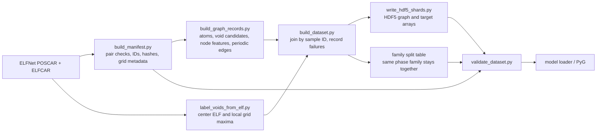

# ELFNet atom/void graph dataset

This package builds a model-ready dataset from the ELFNet POSCAR/ELFCAR pairs.
The graph has two node types, atoms and candidate voids. Structural descriptors
and periodic edges are model inputs. ELF values sampled around each void are
stored separately under `targets/` so they cannot silently leak into the inputs.

## Workflow



| File | Responsibility | Output or contract |
|---|---|---|
| `build_manifest.py` | Index paired files, make stable sample/family IDs, parse POSCAR atom counts and ELFCAR grid dimensions, optionally hash source files | `manifest.parquet` |
| `build_graph_records.py` | Read POSCAR, run the existing candidate-void finder, create atom and void features, and enumerate periodic atom–atom and void–atom edges | In-memory graph record; no ELF target data |
| `label_voids_from_elf.py` | Check that POSCAR and ELFCAR structures match; interpolate ELF at each void and measure local grid maxima and offsets | Per-void target arrays |
| `build_dataset.py` | Orchestrate the two extraction paths, join by sample, record failures, make family-safe splits | Complete version directory |
| `write_hdf5_shards.py` | Validate records and atomically write numeric arrays and UTF-8 metadata | `shards/graphs-*.h5` |
| `schema.json` | Describe manifest and HDF5 storage contracts | Copied into each built dataset |
| `dataset.py` | Load a stored graph and optionally convert it to PyG `HeteroData` | Model input; `targets/` stays separate from `x` |
| `validate_dataset.py` | Check HDF5 shapes, edges, targets, manifest/split membership and optionally source files | JSON validation report and optional void CSV |
| `dataset_config.json` | Store cutoffs, label radii, split seed/fractions and shard size | Versioned build settings |

## Stored output

```text
gnn_void_dataset/v1/
├── config_used.json
├── schema.json
├── manifest.parquet       # one row per source sample directory, including failures
├── splits.parquet         # one row per successfully built sample
├── build_report.json      # counts, fingerprint, and per-sample failures
└── shards/
    ├── graphs-00000.h5
    └── graphs-00001.h5
```

Each HDF5 shard follows this layout:

```text
/samples/<sample_id>/
├── lattice_angstrom                 float [3, 3]
├── atoms/
│   ├── fractional_coords            float [n_atoms, 3]
│   ├── atomic_numbers                integer [n_atoms]
│   ├── features                      float [n_atoms, n_atom_features]
│   └── feature_validity              integer [n_atoms, n_validity_features]
├── voids/
│   ├── fractional_coords             float [n_voids, 3]
│   ├── features                      float [n_voids, n_void_features]
│   ├── method_multi_hot              integer [n_voids, n_methods]
│   └── orbit_multiplicity            integer [n_voids]
├── edges/
│   ├── atom_atom_index               integer [2, n_edges]
│   ├── atom_atom_distance_angstrom   float [n_edges]
│   ├── atom_atom_image_shift         integer [n_edges, 3]
│   ├── void_atom_index               integer [2, n_edges]
│   ├── void_atom_distance_angstrom   float [n_edges]
│   └── void_atom_image_shift         integer [n_edges, 3]
├── targets/
│   ├── elf_at_center                 float [n_voids]
│   ├── elf_max_0.5A / 1A / 1.5A      float [n_voids] per radius
│   └── offset_0.5A / 1A / 1.5A      float [n_voids, 3] per radius
└── metadata/                         source paths, family, counts and settings
```

Edges are directed. `void_atom_index` has void sources and atom destinations;
its periodic `image_shift` is added to the destination's fractional coordinate.
The atom-to-void relation is made by reversing the endpoints and negating that
shift. All destination images inside the configured cutoff are retained.

## Build a bounded pilot

Use a new output path for each build. The builder refuses to write into a
nonempty directory, preventing old shards from being mistaken for current
outputs. Start with a small pilot, inspect its report, then choose a fresh
version output directory for the full run.

```bash
python -m pip install -r elf_void_analysis/requirements.txt
python -m elf_void_analysis.build_dataset \
  --limit 3 \
  --output elfnet_data/gnn_void_dataset/pilot-3
```

`--limit` limits the first sample directories in stable path order. Remove it
for a complete build, and provide a different `--output` path:

```bash
python -m elf_void_analysis.build_dataset \
  --output elfnet_data/gnn_void_dataset/v1
```

Validate the completed output (the validator checks every shard against the
manifest and split table):

```bash
python -m elf_void_analysis.validate_dataset \
  --shards 'elfnet_data/gnn_void_dataset/v1/shards/*.h5' \
  --manifest elfnet_data/gnn_void_dataset/v1/manifest.parquet \
  --splits elfnet_data/gnn_void_dataset/v1/splits.parquet \
  --schema elfnet_data/gnn_void_dataset/v1/schema.json \
  --source-root elfnet_data/extracted/dft-reference/dft-reference-elfs-50000-v1 \
  --require-full-coverage \
  --report-json elfnet_data/gnn_void_dataset/v1/validation.json
```

## Current target interpretation and limits

The labels are ELFCAR `total` grid values. `elf_at_center` is periodic
trilinear interpolation at the candidate coordinate. A local maximum is the
largest raw grid sample inside a periodic Cartesian sphere of the configured
radius; its peak offset is also stored. The sphere is not masked against atoms,
so a local maximum can fall in an atomic basin. These are useful first
supervision targets, but should be inspected before interpreting them as
electron localization specifically at a void. The files do not yet contain a
void-connectivity dimensionality label; that is a separate target-generation
step and is not inferred by this workflow.
