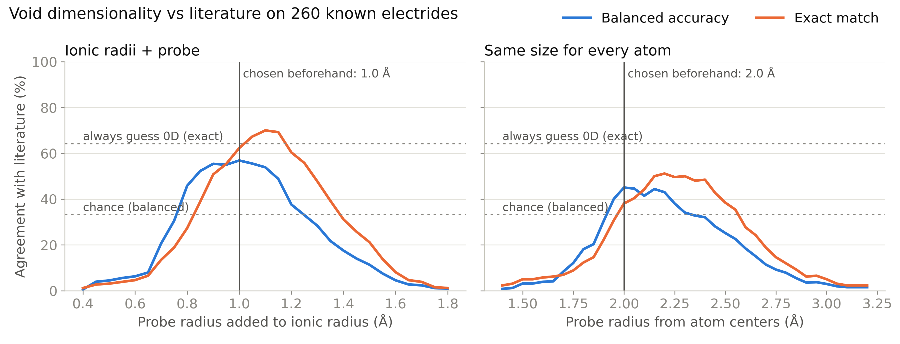
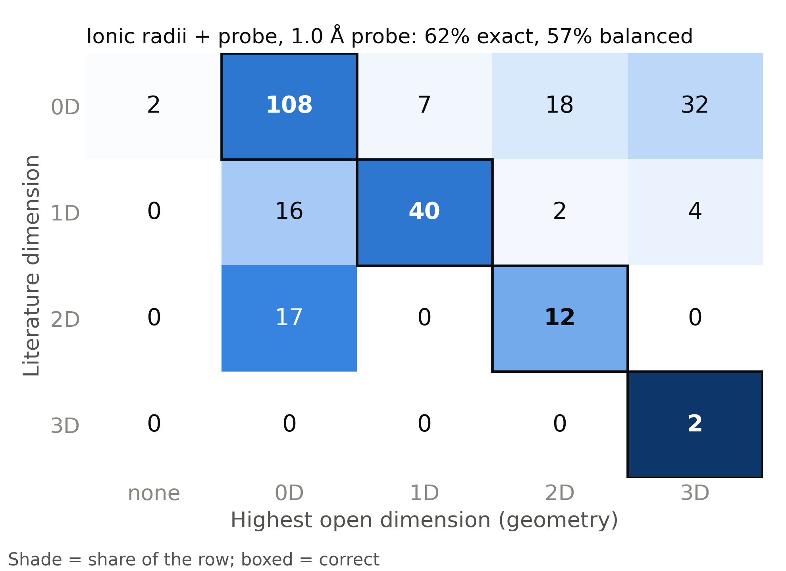

# Void dimensionality on known electrides

`registry_dimensionality_test.py` compares the exact power-diagram void
dimensionality with literature electride dimensionality for every usable entry
in `data/electrides/final_dataset/inorganic_electride_registry_matched.csv`.

## Test set

| Step | Structures |
| --- | ---: |
| Registry entries with a 0D–3D label, an `mp-` ID, a local CIF in `data/cifs/` and a resolved structure match | 291 |
| Excluded: two different literature labels for one structure (e.g. BaAg 0D and 1D) | 28 |
| Excluded: the three case studies used to choose the probes (mp-1019788, mp-12905, mp-2686) | 3 |
| **Scored** | **260** |

Scored labels: 167 0D, 62 1D, 29 2D, 2 3D. Only 9 are experimentally
confirmed; the rest come from computational screens, mainly Magnetic
Electrides (JACS 2023), the ICSD screen (Matter 2019) and Burton et al.
(Chem. Mater. 2018). The literature labels are electronic (mostly from ELF);
the predictions are geometric. The registry itself was assembled from the
literature with an AI search and has not been fully hand-checked.

## Method

For each structure and probe radius, the prediction is the highest dimension
of any open region of the power diagram, or `none` when nothing is open.
Two radius schemes are swept: Shannon ionic radii plus a probe of
0.40–1.80 Å, and a uniform atom-center cutoff of 1.40–3.20 Å, both in 0.05 Å
steps. Balanced accuracy is the mean recall over 0D, 1D and 2D (chance is
33%); 3D has only two structures, so it counts only toward exact accuracy.

## Results

| Setting | Exact match | Balanced accuracy | 0D / 1D / 2D recall |
| --- | ---: | ---: | --- |
| **Ionic + 1.0 Å (chosen beforehand)** | **62.3%** | **56.9%** | 65% / 65% / 41% |
| Ionic, best exact probe (1.1 Å) | 70.0% | 53.9% | 87% / 40% / 34% |
| Uniform 2.0 Å (chosen beforehand) | 38.1% | 45.0% | 30% / 50% / 55% |
| Always guess 0D | 64.2% | 33.3% | |

- Ionic radii beat a uniform cutoff at every scoring choice.
- Tuning the ionic probe on a random half and testing on the other half gives
  68.0% ± 3.1% exact (200 repeats), a small gain over the 1.0 Å default. The
  gain comes from the 0D majority: at 1.1 Å, 1D and 2D recall drop.
- The literature dimension appears at *some* probe for 99% of structures; one
  probe for every material is the main limit.
- The commonest error is a literature 0D electride whose open space connects
  into 2D or 3D (50 of 167). Geometry shows room to connect; the electrons
  stay in separate pockets. ELF at the bottlenecks would be needed to tell
  these apart.
- 17 of 29 literature 2D electrides come out 0D: at this probe their
  interlayer space breaks into separate pockets.





## Files

| File | Contents |
| --- | --- |
| `structures.csv` | One row per structure: literature labels, status, reference, whether scored, and the prediction at each default setting |
| `probe_sweep.csv` | Highest open dimension for every structure, scheme and probe |
| `summary.json` | All metrics, the full accuracy curves and the confusion tables |
| `accuracy_vs_probe.{png,pdf}` | Agreement vs probe for both schemes |
| `confusion_ionic_1p0.{png,pdf}`, `confusion_none_2p0.{png,pdf}` | Literature vs predicted dimension at the default settings |
| `connectivity_flow.{png,pdf}` | Literature dimension vs the channel or sheet stage found by the ionic probe sweep (exploratory; rule chosen after seeing the labels; 3D left out) |

Reproduce from the repository root (about two minutes on 8 cores):

```bash
python -m elf_void_analysis.registry_dimensionality_test \
  --output /path/outside/repository/registry_test
```
